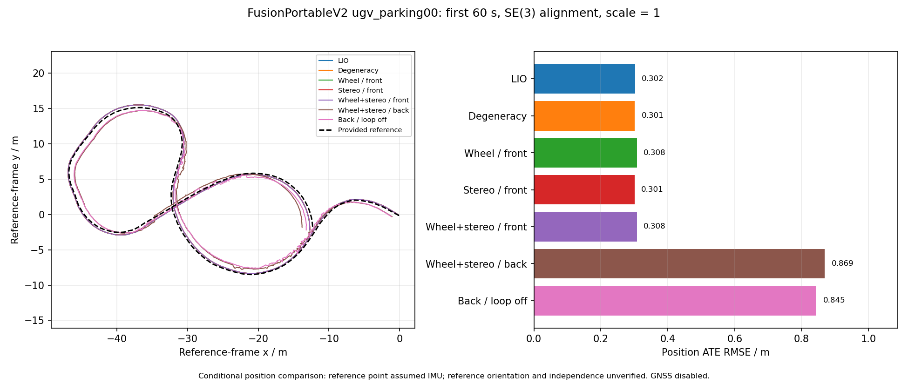

# 验收记录

日期：2026-10-29。本轮完成可运行源码、构建、数学测试、节点集成与真实数据消融；**尚未完成全部精度和硬件验收**。

## 环境与构建

Ubuntu 22.04 / ROS2 Humble / GCC 11 / C++17 / GTSAM 4.2.0；本机 Intel i7-13650HX，20 逻辑线程、约 15 GiB 内存。编译使用单任务、nice 15、空闲磁盘优先级，user systemd 限制 CPU 为半个核心、内存最多 3 GB、不使用 swap。运行时匹配使用 2 个线程，Release -O1，真实 bag 按 1× 顺序回放。

已修复安装后私有共享库的查找路径；`ros2 run` 和 `ros2 launch` 均实际启动成功，launch 节点为 `/fastlio_mapping` 和 `/fastlio_io`，正常退出。

证据：[构建日志](validation-results/build.log)、[安装启动](validation-results/installed-launch.json)。

## 数学与工具测试

- 30 个 GoogleTest 用例通过：21 个核心、9 个后端；colcon 加测试包装器报告 32 tests，0 errors、0 failures、0 skipped。
- 7 个离线 Python 工具测试通过，包括 ROS1→ROS2、扫描结束时间转换、编码器回绕、SE(3) 无尺度拟合、位置真值处理、同时间戳修订和迁移配置检查。
- 覆盖轮速/GPS 雅可比有限差分、克隆及协方差、结构消元、信息不增、退化滞回与严重失配恢复、IMU 重传播与缺测、扫描时间重叠、融合互斥、地图导出、同时间戳激光校正和回环。
- 新增 90° 重访回归测试，复现 Scan Context 航向符号错误；修正后通过。没有放宽 ICP 接受门限来强行加入回环。

原始结果：[C++ 汇总](validation-results/test-summary.log)、[核心 XML](validation-results/test_core.gtest.xml)、[后端 XML](validation-results/test_backend.gtest.xml)、[工具测试](validation-results/tools-tests.log)、[航向修复前](validation-results/yaw-regression-before.log)、[修复后](validation-results/yaw-regression-after.log)。

## 节点级合成测试

输入 200 Hz IMU、10 Hz 点云及辅助观测，独立启动估计器。各项检查融合侧不可动态修改、互斥消费、TF、pose/twist 协方差和地图导出。前端模式的后端 wheel/GNSS/visual 因子均为零；后端模式三类因子均实际加入。

| 场景 | 通过 | 高频输出数 | 有效窗口比例 | 延迟 P95 / ms |
|---|---|---:|---:|---:|
| 后端融合 | 是 | 1160 | 100.000% | 1.18 |
| 前端融合 | 是 | 1160 | 100.000% | 1.06 |
| 轮滑/GPS 跳变/黑屏/激光中断 | 是 | 1160 | 100.000% | 1.10 |
| 时间倒退及会话重置 | 是 | 1099 | 100.000% | 1.21 |
| IMU 缺测及恢复 | 是 | 1060 | 91.379% | 1.31 |
| 扫描重叠 3 ms | 是 | 1159 | 100.000% | 1.19 |
| NaN IMU 及扫描重叠 | 是 | 1158 | 99.914% | 1.46 |

输出比例按初始化后有效窗口计算。时间倒退按会话检查单调性；IMU 缺测测试允许停止有效递推并重新初始化；无效 IMU 测试明确丢弃一个 NaN 样本。P95 是合成发布进程发送到接收高频输出的端到端时间，包含 ROS2 通信，不能代替真实硬件延迟验收。

## 真实数据与评测约定

已下载并转换 FusionPortableV2 `ugv_parking00`，完整约 179 s，1790 帧点云。60 s 消融启用官方标定的轮速和双目；全程组仅启用轮速，输入 bag 没有图像。真实 GNSS 因缺少官方天线杆臂标定关闭，不使用融合 INS 冒充 GPS。数据及转换配方见 [DATASETS.md](DATASETS.md)。

**下表是条件性位置比较**：官方参考轨迹的位置参考点和姿态约定尚未完全确认，暂假定位置属于 body_imu；将估计 base_link 转到 IMU 后做 SE(3) 对齐，尺度固定为 1。参考姿态与车体运动存在约 90° 差异，因此不使用其四元数转换位置，不给旋转 RPE。参考与输入的来源独立性尚未确认。这些数字不能替代参考约定确认后的正式精度验收。

### 前 60 s：七组消融

前端组比较 `/odometry/local`，后端组比较在线 `/odometry/global`。RPE 为 1 s 位置位移向量误差，不声称是使用已验证姿态真值的完整 SE(3) RPE。

| 模式 | 位置 ATE RMSE / m | 1 s 位移 RPE / m | 状态滞后 P95 / ms | 峰值 RSS / MiB | 高频有效窗口比例 |
|---|---:|---:|---:|---:|---:|
| 纯 LIO | 0.302 | 0.099 | 58.4 | 310 | 100.000% |
| 仅退化处理 | 0.301 | 0.099 | 55.8 | 309 | 99.908% |
| 轮速前端 | 0.308 | 0.099 | 55.4 | 449 | 100.000% |
| 双目前端 | 0.301 | 0.099 | 101.0 | 503 | 99.975% |
| 轮速+双目前端 | 0.308 | 0.099 | 99.3 | 489 | 99.992% |
| 轮速+双目后端 | 0.869 | 0.225 | 92.0 | 652 | 100.000% |
| 后端，关闭回环 | 0.845 | 0.270 | 97.3 | 646 | 99.942% |

七组均收到全部 600 帧点云，高频输出中位频率约 200 Hz，无时间倒退。初始化和同步分组使局部输出为 597–599 条。激光队列尾部均值不超过 2，状态滞后 P95 小于 300 ms，未见队列持续增长。前端双目实际更新超过 1100 次；后端组实际加入轮速及视觉因子，完整计数保存在 JSON。

前端组与纯 LIO 的差异很小，单次运行不足以证明显著精度提升。**当前后端多传感器融合精度低于本地 LIO**，还需要确认标定、权重和相对边误差模型。60 s 两个后端组均未触发回环，其差异不能归因于回环；异步时序及观测关联存在运行间变化。

### 全程约 179 s：轮速后端回环对照

| 配置 | 实际回环因子 | 在线全局 ATE / m | 最终优化轨迹 ATE / m | 同运行本地 LIO ATE / m |
|---|---:|---:|---:|---:|
| 开启回环 | 2 | 0.781 | 0.789 | 0.304 |
| 关闭回环 | 0 | 1.455 | 1.460 | 0.304 |

修正航向符号后，全程实际接受 2 个回环；开启组的全局位置误差较关闭组降低，但仍高于本地 LIO。两组均收到全部 1790 帧点云、发布 1789 条局部校正结果，高频有效窗口比例超过 99.99%，没有持续队列积压。后端没有反馈修改本地状态。全程回放没有验证双目或 GNSS 的效果。

地图、关键帧和最终 base_link TUM 轨迹保存在 `results/fusionportable_full/all_backend/export/`；地图约 44 MB。数据与所有本轮结果合计仍小于 30 GB（十进制）。

所有原始统计：[real-results.json](validation-results/real-results.json)，包含在线/最终指标、本地对照、队列、观测计数、峰值 RSS 和可用的构建哈希。回环开启组在航向修正后重跑；保留的前端本地指标及关闭回环组使用不受该修正影响的路径。哈希和版本边界在 JSON 中明确记录。

迁移中发现并修复原 ROS1 launch 顶层地图窗口参数遗漏：最终使用 cube=1000 m、检测范围=100 m、3 次迭代；不满足 cube > 3×range 时启动拒绝。旧窗口结果已排除出正式表格，留在 `results/*before_map_window_fix`；航向修复前的回放留在 `results/before_yaw_fix`。

## 尚未完成的验收与限制

- 原 ROS1 二进制与 ROS2 版同 bag 的迁移对照；当前只完成 ROS2 关闭新增模块的基线。
- 真实 GNSS 融合、Livox 可选编译分支和真实机器人硬件验证。
- ENWIDE 隧道等真实退化场景；官方 Research Collection 本次返回 HTTP 429，未取得 bag。
- 完整路线的双目融合、长时间内存增长、多序列重复运行及统计一致性评测。
- 参考轨迹坐标约定和独立性核实，以及后端融合精度退化的进一步排查。

LIO 相邻边使用保守膨胀的边际近似，不声称严格独立；视觉状态克隆和结构消元也没有额外声称已通过完整不可观性/NEES 一致性证明。全局关键帧与轨迹随路程增长，在线内存不是固定上限。首版不包含地图加载重定位和跨会话合图。
